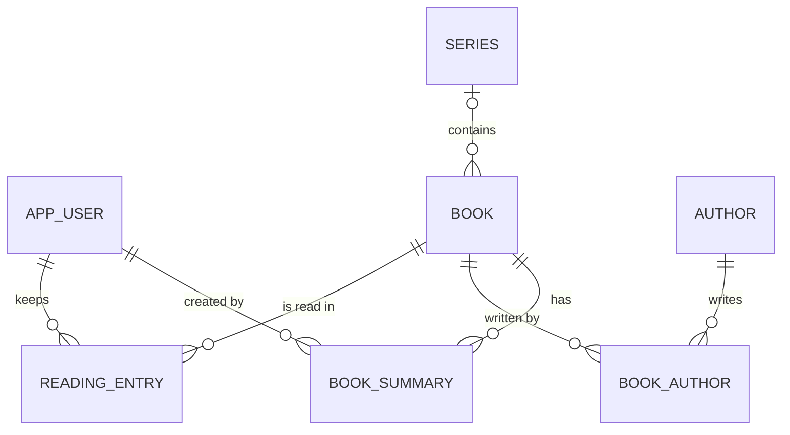

# Family Book Tracker – Specification

Version 0.2 (draft) · Nov 18, 2026 · @john

Changes in 0.2: section 10 (hosting on a Raspberry Pi) added; open question 5 answered; stack table updated (PostgreSQL only, Raspberry Pi hosting).

## 1. Overview and scope

A small web application where each family member signs in and keeps their own record of the books they read. For every book it captures the author, title, series and position in the series, plus a summary that AI can draft from public book information for the reader to review.

### Goals

- Each family member has a private reading list, kept separate from everyone else's.
- Capture author, title, series, number within the series and a summary for each book.
- Let a user record the real name behind an author's pen name. This is optional.
- Cut down on typing: AI drafts the summary (and can suggest series details); the user always reviews before saving.
- Store everything in a relational database.

### Key design decision

Books, authors and series form a **shared family catalog**. What is personal is the **reading entry**, which links a user to a book. This keeps lists separate without anyone retyping "Harry Potter and the Goblet of Fire" a second time, and it lets an AI summary be generated once per book.

### In scope (v1)

- Sign-in, per-user reading lists, catalog of books / authors / series
- Pen name with optional real name
- AI-drafted summary with human review
- Browse, search, sort and filter your own list

### Out of scope (v1)

- Native mobile apps (the web UI should be responsive instead)
- Sharing lists outside the family, social features, recommendations
- Importing from Goodreads / Kindle exports (candidate for v2)

## 2. Users, roles and authentication

| Role | Who | Can do |
| --- | --- | --- |
| Member | Any family member | Manage their own reading entries; add and edit catalog books, authors and series; generate summaries |
| Admin | A parent (one or more) | Everything a Member can, plus create, deactivate and reset accounts |

- **Identification:** every request is tied to the signed-in user. The app never asks "who are you?" per action; it knows from the session.
- **Sign-in:** email (or username for children) plus password, with an optional "Sign in with Google" later. Passwords hashed with Argon2. Sessions in secure, HttpOnly cookies.
- **No self-registration:** an Admin creates accounts, so only family members get in.
- **Data separation:** every reading entry carries a `user_id`. All list, read, update and delete queries are filtered by the authenticated user on the server, never by an id sent from the browser. A user cannot see or change another member's entries in v1.
- **Quick switching:** on a shared family computer, a "Switch user" action signs out and returns to the sign-in screen with recent profiles shown.

## 3. Functional requirements

Priority uses MoSCoW: **M**ust, **S**hould, **C**ould.

| ID | Requirement | Priority |
| --- | --- | --- |
| FR-01 | A user can sign in and sign out. | M |
| FR-02 | An Admin can create, deactivate and reset member accounts. | M |
| FR-03 | A user can add a book to their list with: title (required), one or more authors (required), series (optional), number in series (optional), summary (optional). | M |
| FR-04 | When entering an author or series, the app suggests existing catalog entries (type-ahead) so duplicates are not created; the user can create a new one if none match. | M |
| FR-05 | Number in series accepts decimals (e.g. 2.5 for a novella) and is only allowed when a series is set. | M |
| FR-06 | An author can be marked as a pen name, with an optional real name (e.g. Robert Galbraith → J.K. Rowling). Leaving the real name blank is valid. | M |
| FR-07 | A user can ask the AI to draft a summary for a book (see section 4). | M |
| FR-08 | The AI draft is shown for review; the user can edit, accept, regenerate or discard it. Nothing is saved without acceptance. | M |
| FR-09 | A user can view their own list, sorted and filtered by title, author or series; a series view lists that user's books in series order. | M |
| FR-10 | A user can edit or remove their own reading entries. | M |
| FR-11 | The same book cannot appear twice in one user's list. | M |
| FR-12 | Search across the user's list by title, author (pen name or real name) and series. | S |
| FR-13 | A reading entry can hold status (Want to read / Reading / Finished), date finished and personal notes. | S |
| FR-14 | The AI can suggest series name and number when drafting the summary, for the user to confirm. | S |
| FR-15 | Optional ISBN on a book to make AI lookup more accurate. | S |
| FR-16 | Cover image fetched from the book data source. | C |
| FR-17 | Personal rating (1–5). | C |

## 4. AI-generated summaries

### Where the information comes from

The request names Amazon and Goodreads. Both are good sources of book information, but neither is a reliable thing to build on directly:

- **Goodreads** stopped issuing new API keys in December 2020, and its terms prohibit scraping.
- **Amazon** terms prohibit scraping; its Product Advertising API requires an Amazon Associates account in good standing.

Recommended approach: a pluggable **source adapter** layer.

| Order | Source | Use |
| --- | --- | --- |
| 1 | Google Books API (free key) | Description, series hints, ISBN, cover |
| 2 | Open Library API (no key) | Fallback metadata and description |
| 3 | LLM with a web-search tool (optional) | Fills gaps by reading publicly returned pages; records the URLs it used |

Amazon or Goodreads adapters can be added later if a permitted access route becomes available; the rest of the design does not change.

### Flow

1. User enters title and author (ISBN optional) and selects **Generate summary**.
2. Backend looks up the book through the adapters. If there are several plausible matches, the user picks the right one.
3. Backend sends the gathered descriptions and metadata to the LLM with instructions to write an **original, spoiler-free summary of 100–200 words**, and to return suggested series name and number if found.
4. The draft, its source URLs and any series suggestion are returned to the UI.
5. User edits and **accepts** (saved as the book's current summary) or discards.

### Guardrails

- Never auto-save; acceptance is always a human action.
- Write in its own words; do not copy publisher blurbs or reviews verbatim.
- No spoilers beyond the opening premise.
- If sources disagree or nothing is found, say so instead of guessing.
- Store model name, sources and timestamp with each generated summary.
- Cache lookups by ISBN or by normalized title + author; limit generations per user per day to control cost.
- Timeout of about 30 seconds, with a clear "try again or write your own" message on failure.

## 5. Data model

PostgreSQL is the target; all tables carry `created_at` and `updated_at` timestamps (omitted below). Primary keys are UUIDs.

### Entity relationships

### app\_user

| Column | Type | Rules |
| --- | --- | --- |
| id | uuid | PK |
| display\_name | varchar(100) | required |
| login | varchar(255) | required, unique (email or username) |
| password\_hash | text | required |
| role | varchar(10) | `member` or `admin` |
| is\_active | boolean | default true |

### author

| Column | Type | Rules |
| --- | --- | --- |
| id | uuid | PK |
| name | varchar(200) | required; the name printed on the book |
| sort\_name | varchar(200) | required; e.g. "Rowling, J.K." |
| is\_pen\_name | boolean | default false |
| real\_name | varchar(200) | **optional**; only allowed when `is_pen_name` is true |

Check constraint: `real_name IS NULL OR is_pen_name`. Unique index on lower(`name`).

### series

| Column | Type | Rules |
| --- | --- | --- |
| id | uuid | PK |
| name | varchar(200) | required, unique (case-insensitive) |

### book

| Column | Type | Rules |
| --- | --- | --- |
| id | uuid | PK |
| title | varchar(300) | required |
| series\_id | uuid | FK → series, nullable |
| series\_number | numeric(5,2) | nullable; requires `series_id` |
| isbn\_13 | char(13) | nullable, unique |
| cover\_url | text | nullable |

Check constraint: `series_number IS NULL OR series_id IS NOT NULL`. Unique (`series_id`, `series_number`) where both are set.

### book\_author (many-to-many)

| Column | Type | Rules |
| --- | --- | --- |
| book\_id | uuid | FK → book, PK part |
| author\_id | uuid | FK → author, PK part |
| position | smallint | order of authors on the cover |

### book\_summary

Keeps history; one row per accepted summary, with the latest flagged as current.

| Column | Type | Rules |
| --- | --- | --- |
| id | uuid | PK |
| book\_id | uuid | FK → book, required |
| text | text | required |
| origin | varchar(10) | `ai`, `ai_edited` or `manual` |
| model | varchar(100) | nullable; LLM used |
| source\_urls | jsonb | nullable; list of URLs used |
| created\_by | uuid | FK → app\_user |
| is\_current | boolean | partial unique index: one current per book |

### reading\_entry (the personal record)

| Column | Type | Rules |
| --- | --- | --- |
| id | uuid | PK |
| user\_id | uuid | FK → app\_user, required |
| book\_id | uuid | FK → book, required |
| status | varchar(15) | `want_to_read`, `reading`, `finished`; default `finished` |
| finished\_on | date | nullable |
| notes | text | nullable; private to the user |
| rating | smallint | nullable, 1–5 (Could) |

Unique (`user_id`, `book_id`). Index on `user_id`.

## 6. API outline

JSON REST API under `/api/v1`. All endpoints except sign-in require a session. "My" endpoints resolve the user from the session only.

| Method | Path | Purpose |
| --- | --- | --- |
| POST | /auth/login | Sign in |
| POST | /auth/logout | Sign out |
| GET | /me | Current user |
| GET | /me/readings | My list; query params `q`, `author_id`, `series_id`, `status`, `sort` |
| POST | /me/readings | Add a book to my list (existing `book_id`, or new book details inline) |
| PATCH | /me/readings/{id} | Update status, date, notes |
| DELETE | /me/readings/{id} | Remove from my list (catalog book stays) |
| GET | /authors?q= | Type-ahead search (matches name and real name) |
| POST / PATCH | /authors, /authors/{id} | Create or edit author, including pen name and real name |
| GET | /series?q= | Type-ahead search |
| POST | /series | Create series |
| GET / PATCH | /books/{id} | Read or edit catalog book |
| POST | /books/{id}/summary-drafts | Generate AI draft; returns draft text, sources, series suggestion (not saved) |
| POST | /books/{id}/summaries | Save accepted summary (from draft or manual) |
| GET / POST / PATCH | /admin/users | Admin: list, create, deactivate, reset password |

If the AI call proves slow, `summary-drafts` can switch to `202 Accepted` plus a polling endpoint without changing the rest of the API.

## 7. Non-functional requirements and suggested stack

### Non-functional

- **Scale:** a single family, roughly 2–10 users and a few thousand books. No horizontal scaling needed.
- **Performance:** list pages load in under 1 second; AI draft returns in under 30 seconds.
- **Security:** HTTPS only; Argon2 password hashing; CSRF protection on form posts; ownership checks on every reading-entry query; API keys for the LLM and Google Books held in environment secrets, never in the browser.
- **Privacy:** minimal personal data (display name and login only), which matters with children's accounts. Notes are private to their owner.
- **Backups:** nightly database backup with 30 days retained.
- **Usability:** works on phone, tablet and desktop browsers; adding a book takes no more than a minute.

### Suggested stack

| Layer | Choice |
| --- | --- |
| Language | Python 3.12+ |
| Web / API | FastAPI with Pydantic v2 models |
| UI | Server-rendered Jinja2 templates with HTMX (keeps it one codebase, no separate SPA) |
| Database | PostgreSQL 16 (SQLite only for throwaway local development, per the constitution) |
| ORM / migrations | SQLAlchemy 2.0 + Alembic |
| Auth | Session cookies; `argon2-cffi` for hashing |
| AI | LLM provider SDK (e.g. Anthropic) behind a `SummaryGenerator` interface; `httpx` for Google Books / Open Library |
| Testing | pytest, with recorded HTTP fixtures for source adapters and a fake LLM |
| Hosting | One app container image on a Raspberry Pi 5 at home, behind Caddy, with PostgreSQL in Docker Compose (see section 10) |

## 8. Acceptance criteria

- **AC-01 (separation):** Given Alice and Ben each have books on their lists, when Alice views her list, she sees only her entries; a request by Alice for one of Ben's entry ids returns 404.
- **AC-02 (add book):** Given a signed-in user, when they add a book with title and author only, it is saved and appears in their list; series and number are blank.
- **AC-03 (series):** When a user enters a number in series without choosing a series, the form shows a validation error and nothing is saved.
- **AC-04 (pen name, optional real name):** An author can be saved as a pen name with the real name blank; when a real name is added later, searching by the real name finds the author's books.
- **AC-05 (no duplicates):** Adding a book already on the user's list shows "Already on your list" and creates nothing.
- **AC-06 (shared catalog):** When Ben adds a book Alice already added, the type-ahead offers the existing book; no second catalog row is created.
- **AC-07 (AI draft):** When a user generates a summary, a draft of 100–200 words with at least one source URL is shown, and no summary is stored until the user accepts.
- **AC-08 (AI failure):** When the sources return nothing or the AI times out, the user sees a message and can write the summary by hand.
- **AC-09 (admin):** A deactivated account cannot sign in, and its reading entries are kept.

## 9. Open questions and future enhancements

### Open questions

1. **Visibility:** should family members be able to *see* (not edit) each other's lists, e.g. "who in the family has read this?" The model supports it; v1 hides it.
2. **Summary ownership:** one shared summary per book (current design) or a personal summary per reader? Personal notes already cover individual impressions.
3. **Re-reads:** should reading the same book twice create two entries? Currently blocked by FR-11; allowing it means dropping that unique constraint and adding a read count or one row per read.
4. **Pen names:** is a free-text real name enough, or should pen names link to one another (e.g. Nora Roberts and J.D. Robb as the same person)? A self-referencing `real_author_id` can be added later without breaking anything.
5. **Hosting:** ~~cloud container or a machine at home?~~ **Answered:** a Raspberry Pi 5 at home, reachable only from the family network (section 10). Two parts are still open there: the HTTPS approach (10.5) and the off-site backup destination (10.6).
6. **Children's accounts:** do younger readers need a simpler UI or parental review of what they add?

### Future enhancements

- Import from a Goodreads CSV export or Kindle history
- Barcode scan of ISBN from a phone camera
- Family statistics (books per year, favorite authors)
- "Want to read" lists shared between family members
- Reading challenges and yearly goals

## 10. Hosting: Raspberry Pi on the home network

The app runs on a Raspberry Pi 5 at home. It is reachable only from the family network and never exposed to the internet.

Items marked **Open** must be decided before go-live; items marked **To build** are not in the application yet.

### 10.1 Hardware

| Item | Choice | Why |
| --- | --- | --- |
| Board | Raspberry Pi 5, 4 GB RAM | Ample for 2–10 users and PostgreSQL |
| Storage | NVMe SSD (128–256 GB) on an M.2 HAT | SD cards wear out and can corrupt the database on power loss |
| Power | Official 27 W USB-C supply; small UPS optional | Stable power avoids corruption |
| Cooling | Active cooler, in a case with room for the SSD HAT | Sustained load without throttling |
| Network | Wired Ethernet | Stable address and connection |

### 10.2 Operating system and naming

- Raspberry Pi OS Lite (64-bit), with no desktop.
- Hostname `books`, advertised on the network as `books.local` by Avahi (mDNS). Used for SSH and admin access.
- A DHCP reservation on the router gives the Pi a fixed IPv4 address. It's the fallback where `.local` doesn't resolve (some Android devices).
- **Home network: 192.168.4.0/22.** This is the prefix the Pi receives from the router's DHCP (shown by `ip -4 addr` on the Pi), and it matches the default range of eero routers. **Check before go-live:** confirm the range in the eero app's network settings (DHCP / NAT; menu names vary by app version). The firewall rules below depend on it being exact.

### 10.3 Firewall (ufw)

The default policy denies incoming and allows outgoing. All allowed traffic is limited to the home network.

| Port | Protocol | Purpose | Source |
| --- | --- | --- | --- |
| 22 | TCP | SSH administration | 192.168.4.0/22 |
| 5353 | UDP | mDNS (`books.local`) | 192.168.4.0/22 |
| 80, 443 | TCP | Web app via Caddy | 192.168.4.0/22 |
| 5900 | TCP | VNC, **temporary, for initial setup only** (see below) | 192.168.4.0/22 |

- **VNC is temporary.** Raspberry Pi OS Lite has no desktop, so VNC only works while a desktop and a VNC server are installed for setup. When setup is finished, remove the desktop and the VNC server, and delete the 5900 rule.
- **IPv4 only.** The rules cover IPv4. Clients connect over IPv4 (`ssh -4`, or `AddressFamily inet` in `~/.ssh/config`), or matching `fe80::/10` rules are added.
- **Docker-published ports bypass ufw.** Docker inserts its own iptables rules, so the 80/443 rows don't actually filter Caddy's traffic. The real boundaries are:
  1. only Caddy publishes ports, and binds them to the Pi's LAN address;
  2. PostgreSQL and the app are never published;
  3. the router forwards no ports.
- No port forwarding on the router.

### 10.4 Runtime layout (Docker Compose)

| Container | Image | Role | Published |
| --- | --- | --- | --- |
| proxy | Caddy | HTTPS termination, reverse proxy to `app` | `<pi-ip>:80`, `<pi-ip>:443` |
| app | Book tracker, `linux/arm64` | FastAPI + uvicorn, 2 workers; runs `alembic upgrade head` (and creates the first Admin if missing) before starting | No |
| db | PostgreSQL 16 | Database, with data on the SSD | No |

- **Images (To build):** CI builds multi-architecture images (`linux/arm64` and `linux/amd64`) with `docker buildx` on each merge to `main` and pushes them to GitHub Container Registry, `ghcr.io/muirjc/books`. If the package is private, the Pi signs in to GHCR with a read-only token.
- **Restart and health:** all containers use `restart: unless-stopped`. **To build:** the app exposes an unauthenticated `GET /healthz` for the Docker health check, and the container runs 2 uvicorn workers (today it runs 1).
- **Behind the proxy:** the app runs with `BOOK_TRACKER_ENVIRONMENT=production`, so it redirects plain HTTP to HTTPS and sends HSTS. It trusts `X-Forwarded-Proto` from Caddy; that is safe only because the app port is never published.
- **Outbound internet:** spec 001 makes no outbound calls. From spec 002 (AI summaries), the app needs outbound HTTPS to the LLM API and to Google Books / Open Library.
- **Secrets:** they live in a `.env` file on the Pi with mode 600, never committed. That covers the database password, `BOOK_TRACKER_SECRET_KEY`, the first Admin's password, and later the LLM and Google Books keys.

### 10.5 HTTPS (Open)

The constitution (Principle IX) requires HTTPS here, and the app's `__Host-` session cookie only works over HTTPS. The approach is **not decided**. The options:

| Option | For | Against |
| --- | --- | --- |
| 1. Own domain + Let's Encrypt via DNS challenge (e.g. `books.<family-domain>` pointing to the Pi's private IP) | Trusted on every device with no setup | Needs a domain and a DNS provider with an API. Caddy must be built with that provider's DNS plugin. Routers with DNS rebinding protection block public names that point at private IPs, so the router may need an exception |
| 2. Tailscale with MagicDNS certificates | Trusted; adds secure remote access | Every device needs the Tailscale app. Remote access contradicts "reachable only from the family network", so choosing it means changing that goal |
| 3. Caddy internal CA (`tls internal`) | No domain, no cost | Caddy's root certificate must be installed and trusted on every device, including children's phones and tablets |

The choice also decides the address the family uses (`books.<family-domain>`, a Tailscale name, or `books.local`).

### 10.6 Backups and maintenance

- **Nightly backup:** `pg_dump` (run in the `db` container) on a systemd timer, written to the **NAS** on the home network. 30 days retained.
- **Off-site copy (Open):** an encrypted copy with restic, 30 days retained. The destination isn't chosen (for example Backblaze B2, S3, or a machine at a relative's house). Keep the restic password somewhere other than the Pi, such as the family password manager; without it the backups can't be restored.
- **Restore test:** at least once before go-live, into a scratch database. This is the constitution's release gate (spec 001 task T118).
- **Access:** SSH with keys only; password login disabled.
- **OS updates:** automatic security updates (`unattended-upgrades`).
- **App updates:** `docker compose pull && docker compose up -d`. Migrations run when the app starts.
- **Performance check (To do):** the performance budgets (list pages under 1 s, type-ahead under 0.3 s at p95 with 5,000 books) were measured on a development PC. Re-check them on the Pi with the SSD.
