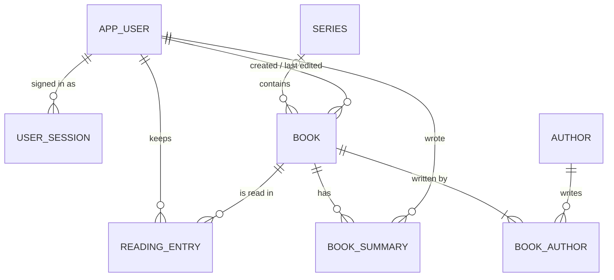
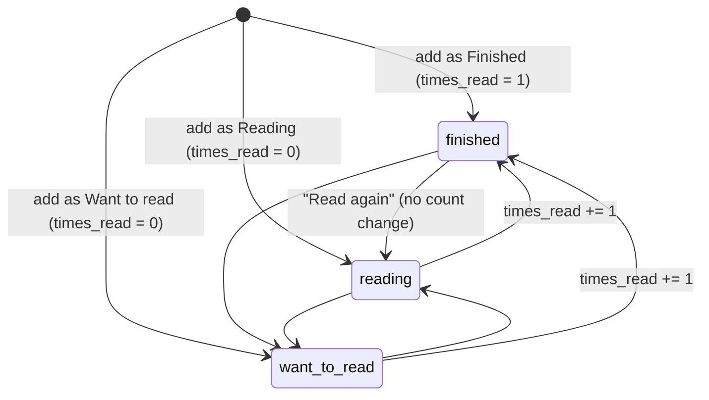

# Data Model: Family Reading List

**Feature**: [spec.md](spec.md) | **Plan**: [plan.md](plan.md) | **Date**: 2026-11-18

PostgreSQL 16+. Every primary key is a UUID generated by the application (`uuid4`). Every
table except `book_author` and `login_throttle` has `created_at` and `updated_at`
(`timestamptz NOT NULL DEFAULT now()`); these are omitted from the tables below.
**Catalog** tables are shared by the family; **Personal** tables belong to one user
(Constitution Principle II).

## Account tables

### app_user

| Column | Type | Rules |
|---|---|---|
| id | uuid | PK |
| display_name | varchar(100) | NOT NULL; trimmed, 1–100 characters |
| login | varchar(255) | NOT NULL; email address or username, 3–255 characters |
| password_hash | text | NOT NULL; Argon2id encoded hash |
| role | varchar(10) | NOT NULL; `CHECK (role IN ('member','admin'))`; default `member` |
| is_active | boolean | NOT NULL; default true |
| must_change_password | boolean | NOT NULL; default true (set on creation and on Admin reset) |

- `UNIQUE INDEX app_user_login_lower_uq ON app_user (lower(login))` (FR-008)
- The rule that at least one Admin stays active is enforced by the service (research R8).

### user_session

| Column | Type | Rules |
|---|---|---|
| id | uuid | PK |
| user_id | uuid | NOT NULL; FK → app_user ON DELETE CASCADE |
| token_hash | char(64) | NOT NULL, UNIQUE; SHA-256 hex of the cookie token |
| csrf_token | varchar(64) | NOT NULL |
| last_seen_at | timestamptz | NOT NULL |
| expires_at | timestamptz | NOT NULL; `last_seen_at + 14 days`, slid forward on use |

- Index on `user_id` (to end all of a user's sessions on deactivation or password change).
- A session is valid only while `expires_at > now()` **and** the user `is_active`.

### login_throttle

| Column | Type | Rules |
|---|---|---|
| login_key | char(64) | PK; HMAC-SHA256 hex of `lower(trim(login))`, keyed with `SECRET_KEY`; the login itself is never stored; also used for logins that match no account |
| failed_count | smallint | NOT NULL; `CHECK (failed_count >= 0)` |
| locked_until | timestamptz | NULL |
| updated_at | timestamptz | NOT NULL |

- State: on each failure, `failed_count` goes up by one. When it reaches 5, `locked_until`
  is set to now + 15 minutes and the count resets to 0. While `locked_until > now()`,
  attempts are refused without being counted. A success deletes the row. Rows
  whose `updated_at` is more than 24 hours old are pruned.

## Catalog tables

All catalog tables carry `created_by` and `updated_by` (`uuid NOT NULL`, FK → app_user
ON DELETE RESTRICT), FR-009 and the clarification of 2026-11-18. Accounts are never
deleted, only deactivated, so the restriction never blocks.

### author

| Column | Type | Rules |
|---|---|---|
| id | uuid | PK |
| name | varchar(200) | NOT NULL; the name printed on the book; trimmed, inner whitespace collapsed |
| sort_name | varchar(200) | NOT NULL; defaults to "Last, First…" from `name`; editable |
| is_pen_name | boolean | NOT NULL; default false |
| real_name | varchar(200) | NULL |

- `CHECK (real_name IS NULL OR is_pen_name)` (FR-014, AC-18)
- `UNIQUE INDEX author_name_lower_uq ON author (lower(name))` (FR-011)

### series

| Column | Type | Rules |
|---|---|---|
| id | uuid | PK |
| name | varchar(200) | NOT NULL; trimmed, inner whitespace collapsed |

- `UNIQUE INDEX series_name_lower_uq ON series (lower(name))` (FR-011)

### book

| Column | Type | Rules |
|---|---|---|
| id | uuid | PK |
| title | varchar(300) | NOT NULL; trimmed, 1–300 characters |
| series_id | uuid | NULL; FK → series ON DELETE RESTRICT |
| series_number | numeric(5,2) | NULL |
| isbn_13 | char(13) | NULL; digits only, checksum validated by the application (FR-015) |

- `CHECK (series_number IS NULL OR series_id IS NOT NULL)` (FR-013, AC-06)
- `CHECK (series_number IS NULL OR (series_number >= 0 AND series_number <= 999.99))` (FR-013)
- `CHECK (isbn_13 IS NULL OR isbn_13 ~ '^[0-9]{13}$')`
- `UNIQUE (isbn_13)`; nulls are not equal, so many books may have no ISBN (FR-011)
- `UNIQUE INDEX book_series_number_uq ON book (series_id, series_number) WHERE series_id IS NOT NULL AND series_number IS NOT NULL` (AC-19)
- Index on `series_id`.
- Books with the same title are allowed (edge case), so no unique index on title.

### book_author

| Column | Type | Rules |
|---|---|---|
| book_id | uuid | PK part; FK → book ON DELETE CASCADE |
| author_id | uuid | PK part; FK → author ON DELETE RESTRICT |
| position | smallint | NOT NULL; `CHECK (position >= 1)`; order on the cover |

- `UNIQUE (book_id, position)`
- At least one author per book (FR-012) is a rule across rows. The service writes a book and
  its authors in one transaction and rejects an empty author list. Pydantic enforces
  `min_length=1`.
- Index on `author_id` (author filter and real-name search).

### book_summary

| Column | Type | Rules |
|---|---|---|
| id | uuid | PK |
| book_id | uuid | NOT NULL; FK → book ON DELETE CASCADE |
| text | text | NOT NULL; 1–5,000 characters after trimming |
| origin | varchar(10) | NOT NULL; `CHECK (origin IN ('ai','ai_edited','manual'))`; this feature writes only `manual` |
| model | varchar(100) | NULL |
| source_urls | jsonb | NULL |
| created_by | uuid | NOT NULL; FK → app_user |
| is_current | boolean | NOT NULL; default true |

- `UNIQUE INDEX book_summary_current_uq ON book_summary (book_id) WHERE is_current` (FR-024)
- `CHECK (origin = 'manual' OR model IS NOT NULL)`: AI summaries must name their model
  (Constitution Principle III; used from spec 002 onward)
- Saving a new summary sets the previous current row's `is_current` to false and inserts
  the new row, in one transaction. History is never deleted.

## Personal tables

### reading_entry

| Column | Type | Rules |
|---|---|---|
| id | uuid | PK |
| user_id | uuid | NOT NULL; FK → app_user ON DELETE RESTRICT; **always set from the session** |
| book_id | uuid | NOT NULL; FK → book ON DELETE RESTRICT |
| status | varchar(15) | NOT NULL; `CHECK (status IN ('want_to_read','reading','finished'))`; default `finished` |
| finished_on | date | NULL; `CHECK (finished_on IS NULL OR finished_on >= DATE '1900-01-01')`; not in the future (validated in the application, research R8) |
| times_read | smallint | NOT NULL; `CHECK (times_read BETWEEN 0 AND 99)` |
| notes | text | NULL; at most 10,000 characters; private to the owner |

- `UNIQUE (user_id, book_id)` (FR-017, AC-05)
- Index on `user_id`; index on `book_id`.
- `ON DELETE RESTRICT` on `book_id` means a catalog book can't be deleted while it's on
  anyone's list. Catalog deletion is out of scope (spec Assumptions).

#### Status and times read (FR-029)

- Any change **into** `finished` from another status increments `times_read` (capped at
  99) and sets `finished_on` to the date given, or to today if none is given.
- The member may edit `times_read` directly in the range 0–99. A direct edit in the same
  request as a status change replaces the automatic increment.

## Ownership and access summary

| Table | Ownership | Read | Write |
|---|---|---|---|
| app_user | Account | Owner (self); Admins (all; not `password_hash`) | Admins; owner changes own password |
| user_session, login_throttle | System | Server only | Server only |
| author, series, book, book_author, book_summary | Catalog | All signed-in members | All signed-in members |
| reading_entry | Personal | Owner only, including the Admin's own entries | Owner only |

Every `reading_entry` query goes through `ReadingEntryRepository`, which is created with
the session user's id and adds `WHERE user_id = :session_user` to every statement
(Constitution Principle I). The repository has no method that takes a user id from its
caller.
